# Diagrams

How the library is put together, what passes between a device and its subscribers, and the
states each part moves through. Terms are those of [CONTEXT.md](../CONTEXT.md). Names in
`code font` are the ones in the source.

1. [Structure](#1-structure)
2. [What Tango carries and what UCX carries](#2-what-tango-carries-and-what-ucx-carries)
3. [A subscription from Open to Close](#3-a-subscription-from-open-to-close)
4. [The path of a frame](#4-the-path-of-a-frame)
5. [Publisher instance states](#5-publisher-instance-states)
6. [Session states](#6-session-states)
7. [Subscription states](#7-subscription-states)
8. [Source slot states](#8-source-slot-states)
9. [Receive slot states](#9-receive-slot-states)
10. [Public types](#10-public-types)
11. [What owns what](#11-what-owns-what)

## 1. Structure

The parts of each process and the source file each one is in. The two processes meet in two
places only: Tango, and UCX.

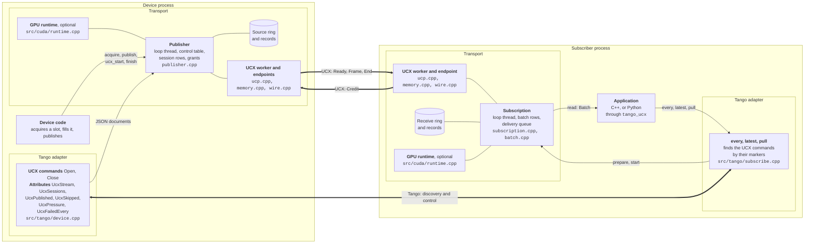

## 2. What Tango carries and what UCX carries

Tango carries what happens once for a subscription, as JSON documents. UCX carries what happens
for each frame, as active messages between the two loop threads. No Tango call is made on a
loop thread, and no frame passes through Tango.

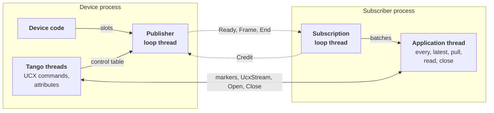

Solid lines are Tango or calls within a process. Dotted lines are UCX.

| Carried by | Message | From | When |
|---|---|---|---|
| Tango | `command_list_query`, for the markers | subscriber | once, to find the UCX commands |
| Tango | read `UcxStream` | subscriber | once, for the instance ID and description |
| Tango | Open | subscriber | once, with the session, ring depth, batch size, delivery and UCX address |
| UCX | Ready | publisher | once, when the session is granted |
| UCX | Frame | publisher | for each frame, with its sequence, record and payload |
| UCX | Credit | subscriber | as receive slots are released; it is cumulative |
| UCX | End | publisher | once, with the sequences and frames sent and the reason |
| Tango | Close | subscriber | once, with the session |

## 3. A subscription from Open to Close

One every subscription, from finding the device to closing the session. The arrows with an
open head are UCX active messages. Every other message between the two processes is a Tango
call.

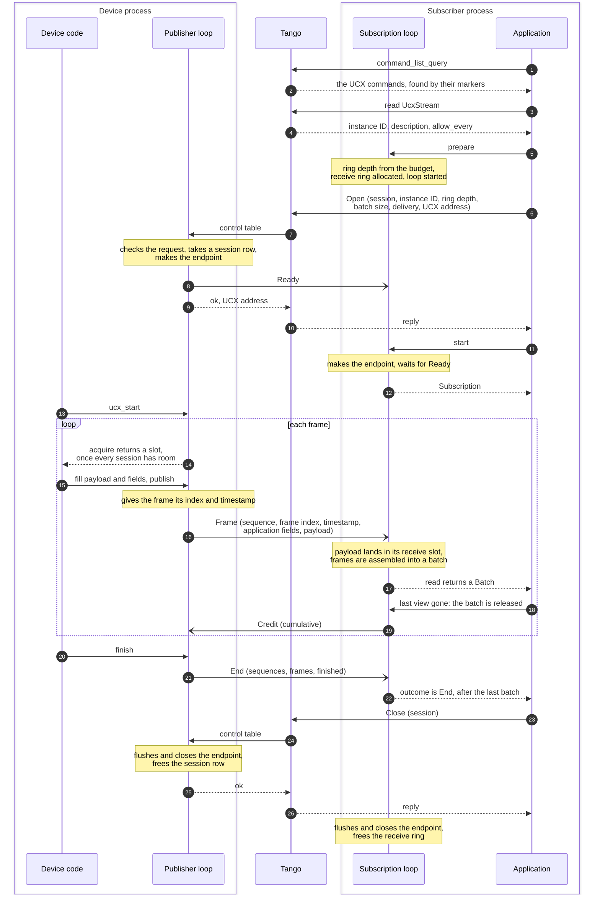

## 4. The path of a frame

What decides whether a frame is sent, skipped or held back, on each side. The grant is where
pressure is applied: the device gets no slot until every session that must receive the frame
has room for it. Credit from the subscriber is what gives a session room again.

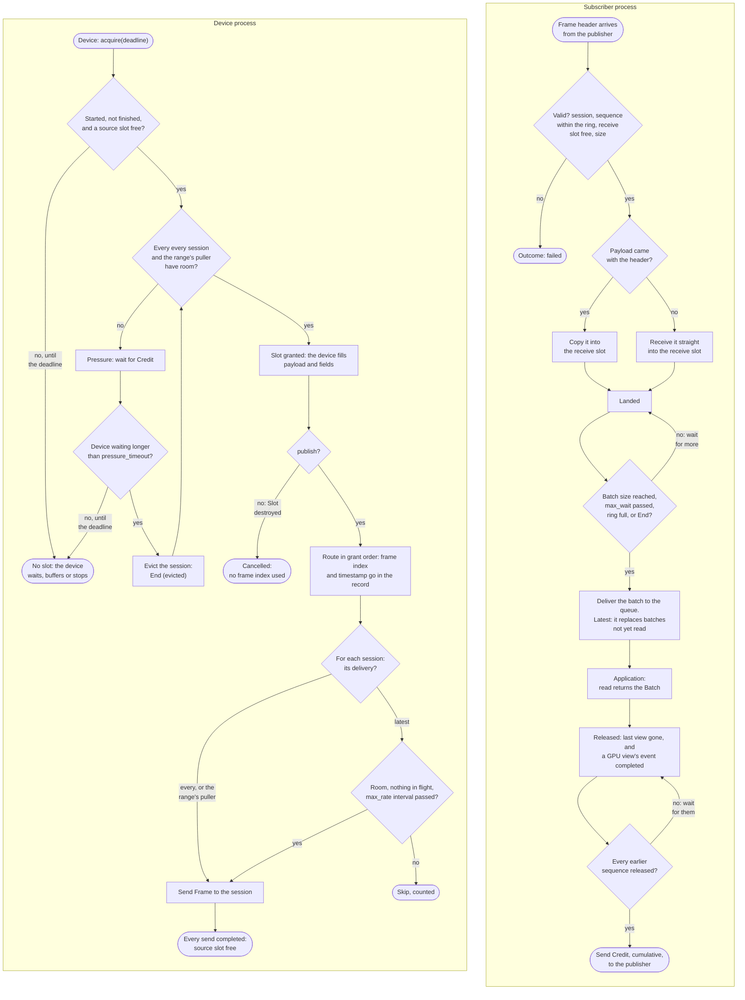

## 5. Publisher instance states

One publisher instance, from construction to finish. Each new instance has a new instance ID
and restarts the frame index.

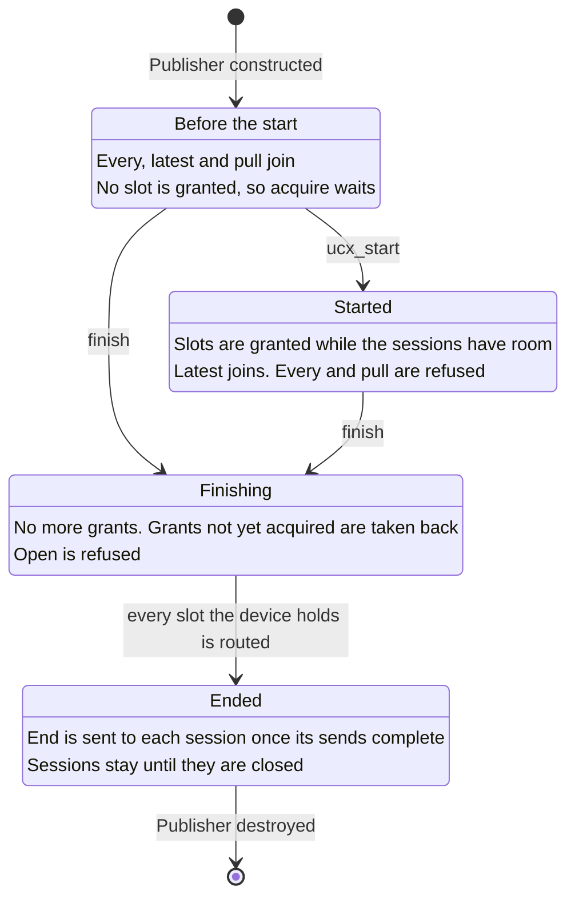

A publisher destroyed in any state sends End (closing) to the sessions it still has and closes
them. What is not closed three seconds later goes to quarantine.

## 6. Session states

One row of the publisher's session table.

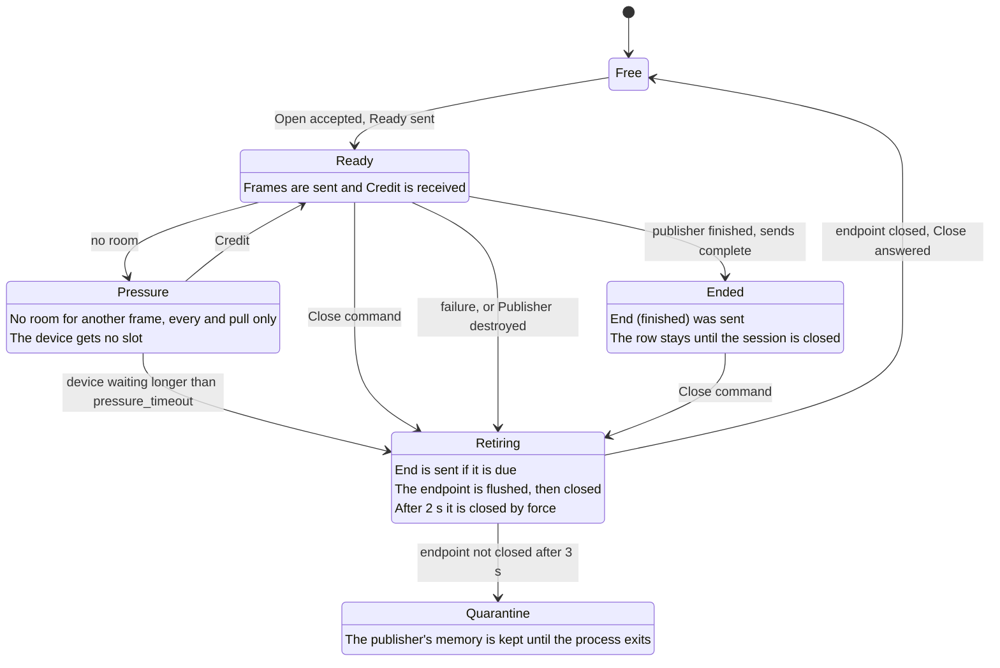

Why a session retires decides whether End is due:

| Cause | End |
|---|---|
| Close command | none |
| UCX reports the endpoint failed, or a send failed | none |
| Eviction | End (evicted) |
| Credit for more than was sent, or a send the subscriber rejected | End (protocol) |
| Publisher destroyed | End (closing) |

An Open that is not accepted leaves the row free and answers with a status: `instance_id`,
`finished`, `every-refused`, `started`, `malformed`, `range`, `no-session`, `endpoint`, `busy`
or `timeout`.

## 7. Subscription states

One subscription, as the subscriber sees it. End, Failed and Cancelled are the three outcomes.
Batches delivered before the outcome can still be read, and the outcome is reported once the
last of them has been.

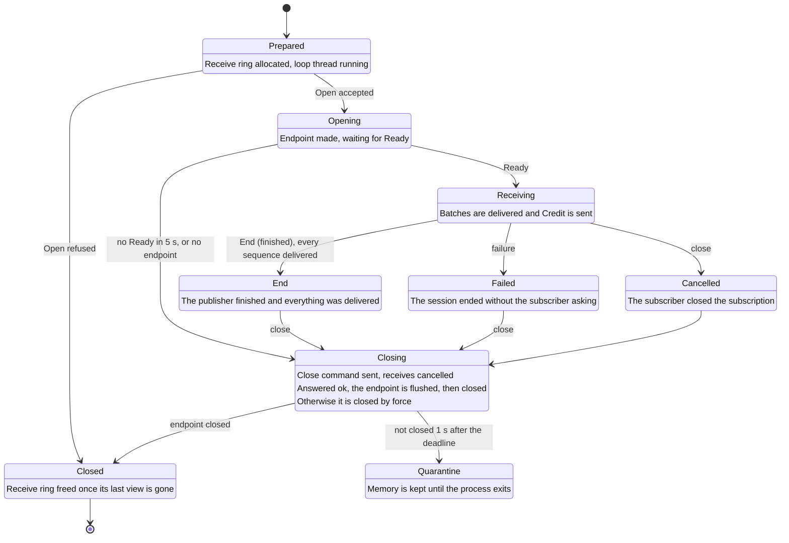

A subscription fails when:

- End arrives with the reason evicted, protocol or closing;
- UCX reports the publisher unreachable;
- a frame is invalid, or its transfer fails;
- a sequence below End has not arrived two seconds after the last frame;
- an every subscription reaches End with a frame index missing;
- a puller reaches End and its set has missing frames;
- Credit cannot be sent;
- a GPU event fails.

## 8. Source slot states

One slot of the publisher's source ring.

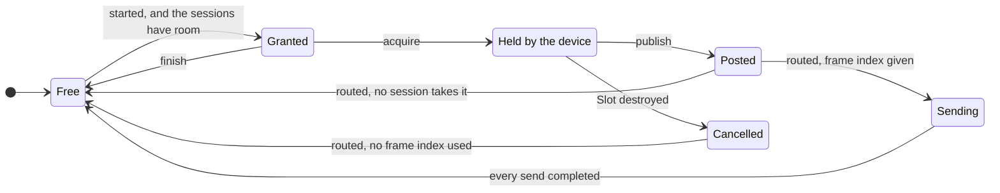

Slots are routed in the order they were granted, so a slot posted early waits for the ones
granted before it.

A GPU source slot is written through `gpu_payload` on one GPU stream. Publishing or cancelling
it records an event on that stream, and the slot is not routed until the event completes. An
event that fails finishes the publisher and ends its sessions with End (protocol).

## 9. Receive slot states

One slot of a subscription's receive ring. The sequence picks the slot.

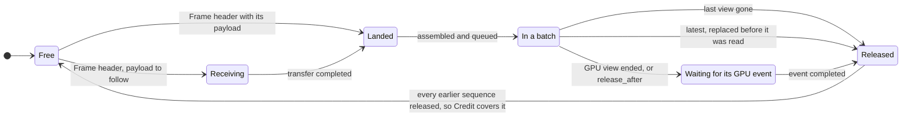

`release_after` is for pinned host receive: the batch's slots wait for the uploads queued on
the GPU stream. A GPU event that fails leaves its slots held: they are never credited, the
subscription fails, and its receive ring goes to quarantine.

## 10. Public types

The types of `tango-ucx/ucx.h` and the functions of `tango-ucx/tango.h`.

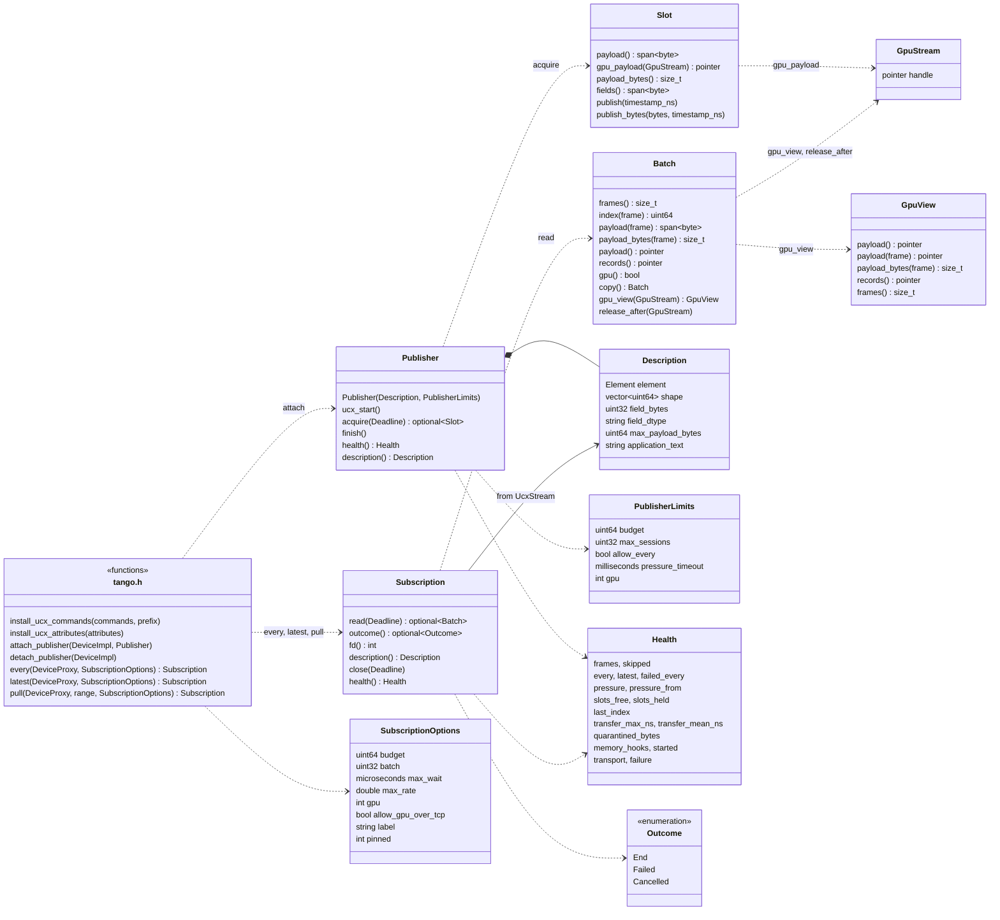

## 11. What owns what

The fixed tables behind the public types. Everything here is allocated once, at setup, from
the budget.

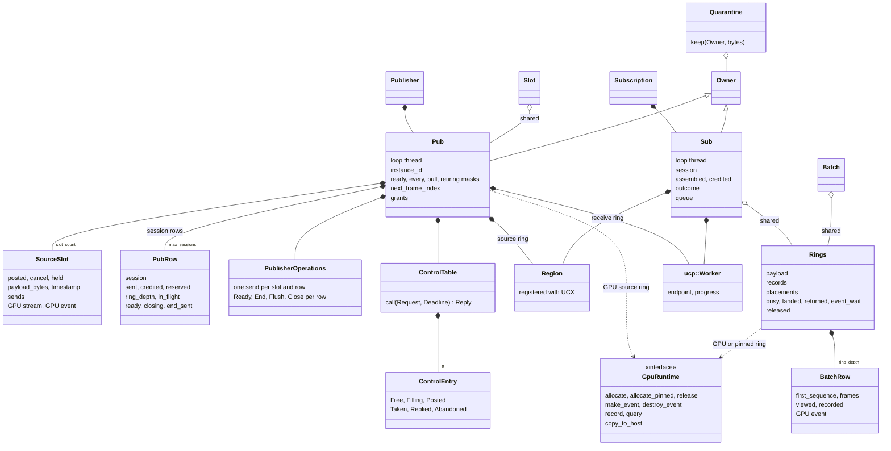
